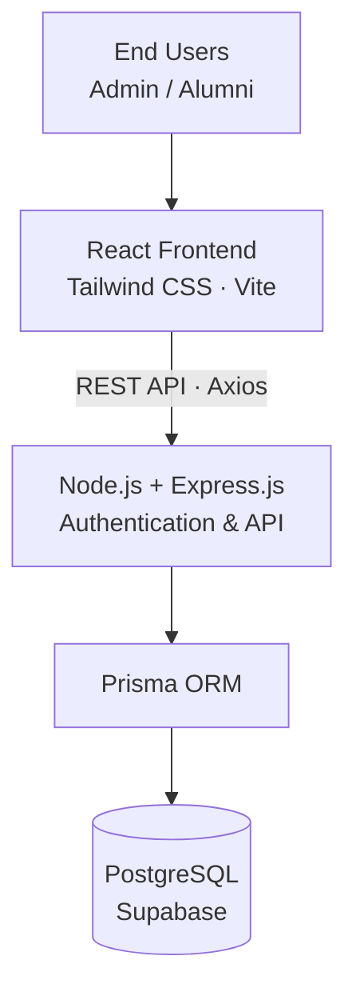
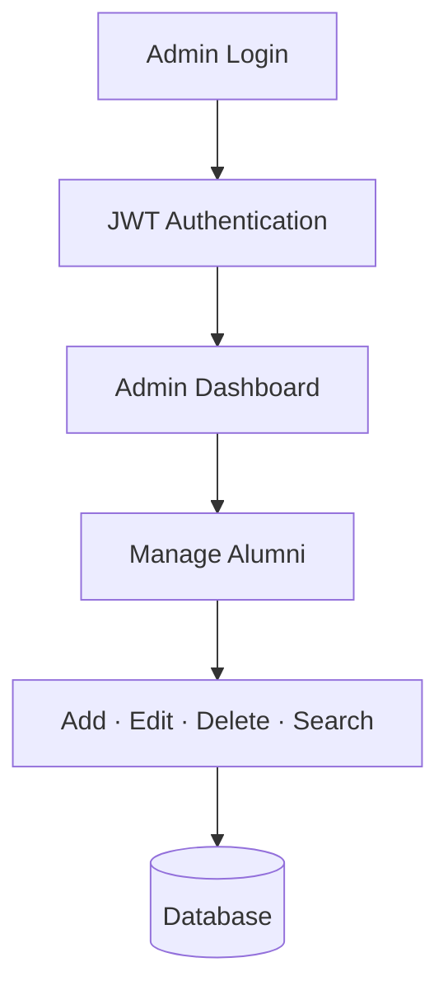
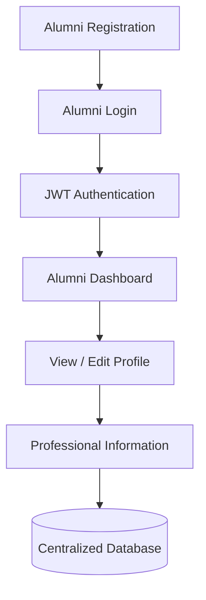
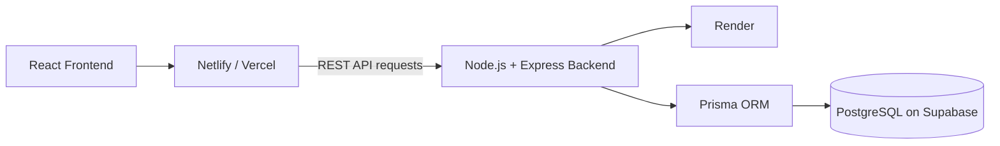

[README (1).md](https://github.com/user-attachments/files/34146253/README.1.md)<div align="center">

# 🌐 AmiSphere
### **Your alumni network. One connected universe.**

*A full-stack Alumni Management Portal built to keep institutional records organized, alumni profiles up to date, and meaningful connections within reach.*

<p>
  
  
  
  
</p>
<p>
  
  
  
  
</p>

**AmiSphere turns scattered alumni records into a connected, maintainable campus network.**

</div>

---

## 🧭 Navigate the README

<details open>
<summary><strong>Explore project sections</strong></summary>

- [Why AmiSphere?](#-why-amisphere)
- [Problem Statement](#-problem-statement)
- [Goals](#-project-goals)
- [Features](#-features)
- [System Architecture](#-system-architecture)
- [Technology Stack](#-technology-stack)
- [How It Works](#-how-it-works)
- [Authentication & Security](#-authentication--security)
- [Database Design Overview](#-database-design-overview)
- [Project Structure](#-project-structure)
- [Environment Variables](#-environment-variables)
- [API Overview](#-api-overview)
- [Deployment](#-deployment)
- [Benefits & Impact](#-benefits--impact)
- [Future Roadmap](#-future-roadmap)
- [Author & License](#-author--license)

</details>

---

## 🌌 Why AmiSphere?

College creates a network that can last a lifetime—but alumni information often ends up spread across spreadsheets, disconnected databases, and outdated records. AmiSphere brings that information into one structured platform.

It gives administrators the tools to maintain institutional records while allowing alumni to take ownership of their own professional information. The result is a more organized, accessible foundation for long-term alumni engagement.

> **The idea:** less time maintaining records manually, more room for alumni connections to grow.

## 🎯 Problem Statement

Traditional alumni management often runs into the same roadblocks:

- 🗂️ Alumni information is scattered across multiple files and platforms.
- ⏳ Manual data maintenance takes time and effort.
- 🔄 Records become outdated as jobs, organizations, skills, locations, and contact details change.
- 🔎 Searching and filtering large alumni datasets can be inefficient.
- 👥 Administrators cannot continuously track every alumnus.
- ✍️ Alumni may not have a dedicated platform to update their own information.

**AmiSphere addresses these challenges through centralized data management and alumni self-service.**

## 🚀 Project Goals

- Centralize alumni information in a structured database.
- Reduce dependence on spreadsheets and manual record maintenance.
- Let alumni independently update their professional profiles.
- Give administrators efficient record-management tools.
- Implement secure authentication and role-based access control.
- Improve alumni discoverability and networking.
- Establish a scalable foundation for future alumni-engagement features.

---

## ✨ Features

### 🛡️ Admin Portal

| Capability | What it enables |
|---|---|
| Admin authentication | Dedicated sign-in for administrators |
| Admin dashboard | A central place to oversee alumni records |
| Statistics & analytics | At-a-glance alumni information and metrics |
| Alumni record management | Add, edit, view, and delete alumni records |
| Search & filtering | Find records across the alumni dataset |
| Alumni directory | Browse centrally maintained alumni information |
| Bulk CSV/XLSX upload | Import multiple alumni records in one workflow |
| Detailed profiles | View individual alumni information |
| Centralized management | Maintain institutional alumni information from one place |

### 🎓 Alumni Portal

| Capability | What it enables |
|---|---|
| Registration & secure login | Create an account and access the alumni portal |
| Personalized dashboard | A personal starting point after login |
| Profile completion tracking | See progress toward a more complete profile |
| View & edit profile | Maintain personal information |
| Academic information | Update educational details |
| Employment details | Keep current professional information up to date |
| Technical skills | Add relevant skills |
| Professional links | Add LinkedIn and other professional links |
| Higher studies information | Record further-education details |
| Government examination information | Maintain relevant examination details |
| Alumni directory/network | Discover other alumni in the network |

### 🔐 Authentication & Authorization

- JWT-based authentication
- Password hashing with `bcrypt`
- Role-based access control (RBAC)
- Protected routes
- Separate Admin and Alumni permissions
- Protected API access

---

## 🏗️ System Architecture

AmiSphere uses a client-server architecture. The React client communicates with the Node.js/Express REST API; Prisma provides the database access layer between the backend and PostgreSQL hosted on Supabase.



### Architecture at a glance

1. **Frontend:** renders the Admin and Alumni experiences.
2. **REST API:** carries requests between the frontend and backend.
3. **Backend:** handles authentication, authorization, and application operations.
4. **Prisma ORM:** provides the database access layer.
5. **PostgreSQL on Supabase:** stores structured application data.

---

## 🧰 Technology Stack

<details open>
<summary><strong>Frontend</strong></summary>

- React.js
- JavaScript (ES6+)
- HTML5
- CSS3
- Tailwind CSS
- React Router DOM
- Axios
- React Context API
- Vite

</details>

<details>
<summary><strong>Backend</strong></summary>

- Node.js
- Express.js
- REST APIs
- JWT Authentication
- `bcrypt.js`
- CORS
- `dotenv`

</details>

<details>
<summary><strong>Database</strong></summary>

- PostgreSQL
- Prisma ORM
- Supabase

</details>

<details>
<summary><strong>Development & Deployment</strong></summary>

- Git
- GitHub
- Render
- Netlify / Vercel

</details>

---

## 🔄 How It Works

### Admin workflow



### Alumni workflow



---

## 🔒 Authentication & Security

The authentication process follows this sequence:

1. The user enters an email address and password.
2. The frontend sends the credentials to the backend using Axios.
3. Express.js receives the authentication request.
4. The backend verifies the user's credentials.
5. The password is validated using `bcrypt`.
6. A JWT is generated after successful authentication.
7. The token and user information are returned to the frontend.
8. Protected routes use authentication state and the user's role.
9. The JWT is attached to subsequent API requests.
10. The backend validates the token before allowing protected operations.

> **Security note:** Never commit `.env` files, passwords, tokens, or database credentials to GitHub. If any real or reusable credentials have already been published, rotate them before sharing the repository.

---

## 🗄️ Database Design Overview

AmiSphere uses **PostgreSQL**, hosted through **Supabase**, as its relational database. **Prisma ORM** acts as the data-access layer between the Node.js backend and PostgreSQL.

The database stores structured information related to:

- User accounts
- Authentication
- Alumni profiles
- Academic information
- Employment details
- Skills
- Professional links
- Profile information

---

## 📁 Project Structure

```text
AmiSphere/
├── frontend/
│   ├── src/
│   │   ├── api/
│   │   ├── components/
│   │   ├── constants/
│   │   ├── context/
│   │   ├── layouts/
│   │   ├── pages/
│   │   ├── routes/
│   │   ├── App.jsx
│   │   ├── main.jsx
│   │   └── index.css
│   ├── public/
│   ├── package.json
│   └── vite.config.js
│
├── backend/
│   ├── config/
│   ├── middleware/
│   ├── routes/
│   ├── controllers/
│   ├── prisma/
│   ├── app.js
│   ├── server.js
│   └── package.json
│
└── README.md
```

---

## ⚙️ Environment Variables

Configure environment variables in the appropriate frontend and backend environment files.

### Frontend

| Variable | Description |
|---|---|
| `VITE_API_URL` | Backend API base URL |

### Backend

| Variable | Description |
|---|---|
| `PORT` | Port on which the backend runs |
| `DATABASE_URL` | PostgreSQL/Supabase connection string |
| `JWT_SECRET` | Secret used to sign JWT tokens |
| `CLIENT_URL` | Allowed frontend origin(s) |
| `NODE_ENV` | Application environment |

**Important:** Keep environment files out of version control. Set production variables in the hosting provider's environment settings, and use strong, private secrets.

---

## 📡 API Overview

The backend exposes REST APIs for authentication, alumni management, and data uploads.

### Authentication

| Method | Endpoint | Purpose |
|---|---|---|
| `POST` | `/api/auth/login` | Authenticate a user |
| `GET` | `/api/auth/me` | Retrieve the authenticated user's information |

### Alumni Management

| Method | Endpoint | Purpose |
|---|---|---|
| `GET` | `/api/alumni` | Retrieve alumni records |
| `GET` | `/api/alumni/:id` | Retrieve a specific alumni record |
| `POST` | `/api/alumni` | Create an alumni record |
| `PUT` | `/api/alumni/:id` | Update an alumni record |
| `DELETE` | `/api/alumni/:id` | Delete an alumni record |
| `GET` | `/api/alumni/stats` | Retrieve alumni statistics |

---

## ☁️ Deployment

AmiSphere uses a separated deployment architecture:



| Layer | Technology / Platform |
|---|---|
| Frontend | Netlify or Vercel |
| Backend API | Render |
| Database | Supabase (PostgreSQL) |
| Database access | Prisma ORM |

The frontend and backend are deployed separately, with the frontend communicating with the backend through the REST API.

---

## 📈 Benefits & Impact

- **Centralized data:** Alumni information is maintained in one structured system.
- **Less manual work:** Administrators can manage records through a dedicated dashboard.
- **Self-service updates:** Alumni can maintain their own professional information.
- **Improved accessibility:** Authorized users can access information through a web interface.
- **Better organization:** Relational storage supports consistent data management and retrieval.
- **Role-based security:** Admin and Alumni users have separate permissions.
- **Room to grow:** The architecture can support additional alumni-engagement features over time.

## 🔭 Future Roadmap

These are potential enhancements, not claims that they are already implemented.

- [ ] Alumni-to-alumni messaging
- [ ] Mentorship programs
- [ ] Job and internship opportunities
- [ ] Alumni event management
- [ ] Email and notification system
- [ ] Advanced analytics and reporting
- [ ] Alumni achievements and recognition
- [ ] LinkedIn integration
- [ ] Mobile application
- [ ] AI-powered alumni networking and recommendations
- [ ] University-wide deployment

---

## 💥 Project Impact

AmiSphere moves alumni management beyond spreadsheets by combining **administrative control with alumni self-service**.

Rather than relying entirely on administrators to maintain every record, graduates can update their own professional profiles while administrators retain control over institutional records. This reduces manual maintenance, improves data freshness, and creates a stronger foundation for long-term alumni engagement.

---

## 👨‍💻 Author

**Vaivasvat Mathur**  
B.Tech Information Technology (2024–2028)  
Amity University, Noida

---

## 📄 License

This project was developed for **academic and educational purposes**.

---

<div align="center">

**Built with purpose — to keep alumni connections alive.** 🌐

<sub>AmiSphere · Alumni Management Portal</sub>

</div>
